# O que o total nacional não conta

*Uma investigação sobre publicidade, mercados e tempo — a história da EDA deste TCC com Google Meridian*

## Prólogo — A publicidade ajudou?

Imagine cuidar da publicidade de uma empresa que atende muitos mercados. Toda semana chega uma planilha: quanto foi gasto, quantos anúncios foram exibidos e quantas ações os clientes realizaram. A pergunta parece simples. Depois de todo esse investimento, a publicidade ajudou?

Talvez o resultado tenha aumentado. Mas também havia mais gente procurando o produto. Talvez uma promoção tenha coincidido com os anúncios. Talvez a empresa tenha escolhido investir justamente onde já esperava vender mais. Mesmo uma semana sem crescimento pode esconder uma contribuição importante: sem publicidade, o resultado poderia ter sido pior.

Esse último pensamento revela a dificuldade. Vemos o que aconteceu. Não vemos, no mesmo lugar e na mesma semana, o que teria acontecido se a empresa tivesse tomado outra decisão. Comparar o resultado com a semana anterior não resolve automaticamente o problema, porque o mundo também mudou entre as duas semanas.

Agora imagine que alguém entregue apenas o total nacional. Temos uma linha que sobe e desce ao longo dos meses. Ela resume o resultado, mas não conta quem participou de cada movimento. Uma semana estável pode ter sido tranquila em todos os mercados ou ter combinado grandes avanços em alguns com quedas em outros. O mesmo número final pode nascer de histórias diferentes.

É nessa distância entre o número e a história que começa este trabalho. Antes de tentar atribuir resultados à publicidade, precisamos descobrir o que os dados deixam enxergar. Será que guardar o endereço de cada observação oferece pistas que desaparecem quando somamos tudo?

A empresa desta abertura é uma imagem para ajudar a pensar. Os dados que vamos investigar são simulados, publicados pelo projeto Google Meridian. Não pertencem a uma marca real, e os nomes dos mercados não identificam cidades. Podemos observar seus padrões e estudar métodos com eles; não podemos inventar campanhas, feriados ou decisões comerciais para explicar o que encontramos.

## Capítulo 1 — Antes do modelo, o terreno

Para responder à pergunta da publicidade, gostaríamos de acompanhar várias coisas ao mesmo tempo. O resultado da empresa, a presença dos anúncios, as mudanças de demanda e outros fatores capazes de participar da história. Olhar uma coluna isolada seria como tentar entender uma partida acompanhando apenas um jogador.

É para enfrentar esse problema que existe o **Marketing Mix Modeling**, ou **MMM**. Ele usa modelos estatísticos para relacionar a evolução do resultado às ações de marketing e a outros fatores. A ambição é entender a contribuição dessas ações, inclusive o que poderia mudar sob decisões diferentes. Fazer essa passagem exige hipóteses sobre como os dados foram produzidos; ver duas coisas mudarem juntas não demonstra que uma provocou a outra. É essa diferença entre acompanhar e causar que precisamos respeitar quando falamos em efeitos causais. Um modelo não resolve a distinção só porque realiza muitos cálculos.

O Google Meridian é a ferramenta escolhida para a futura modelagem deste TCC. Contudo, ter uma ferramenta disponível não significa que seja hora de utilizá-la para estimar efeitos. Primeiro precisamos saber se temos as peças necessárias para formular uma pergunta que ela consiga enfrentar.

Pense em uma construção. Antes de escolher paredes e acabamentos, precisamos conhecer o terreno. Um desenho pode parecer excelente e ainda ser inadequado ao solo. Aqui, o terreno são os dados: onde existem registros, quanto eles mudam e quais coisas aparecem sempre juntas. A **análise exploratória de dados**, abreviada como **EDA**, é essa investigação anterior à construção.

Se um canal aparece apenas em poucas semanas, teremos uma situação diferente daquela em que ele está presente continuamente. Se todos os canais aumentam juntos, observar o resultado depois do aumento pode não revelar qual deles participou mais. Se mercados maiores apresentam mais publicidade e mais resultados, comparar volumes sem considerar tamanho pode nos conduzir a uma história enganosa.

Não precisamos resolver esses problemas neste primeiro momento. Precisamos aprender a reconhecê-los. Ao final da EDA, queremos saber o que vale a pena perguntar ao modelo, que cuidados ele terá de incorporar e quais respostas ainda estarão fora de alcance.

Para isso, deixaremos a planilha se tornar concreta. Antes de investigar relações entre suas colunas, precisamos conhecer o que cada uma está tentando representar.

## Capítulo 2 — Uma semana, um mercado, uma linha

Imagine uma ficha semanal para cada mercado da empresa. Nela registramos o resultado daquela semana e as condições que o acompanharam. Na semana seguinte, fazemos outra ficha para o mesmo lugar. Repetindo esse processo para todos os mercados, conseguimos acompanhar tanto suas diferenças quanto suas mudanças.

A base deste projeto tem exatamente essa organização. São **40 mercados**, identificados de `Geo0` a `Geo39`, acompanhados durante **156 semanas**, de 25 de janeiro de 2021 a 15 de janeiro de 2024. Cada linha corresponde a um mercado em uma semana. A palavra `geo` funciona como o endereço da ficha, embora seja um endereço fictício, sem coordenadas que autorizem desenhar um mapa real.

O resultado que queremos compreender está na coluna `conversions`. Em marketing, uma conversão costuma ser uma ação desejada, como uma compra ou um cadastro. Aqui, porém, temos valores sintéticos, inclusive decimais. Não sabemos qual ação comercial concreta estaria sendo contada. Portanto, vamos chamá-los de conversões simuladas. Esse é o indicador central que acompanhamos — o **KPI**, sigla usada para um indicador de interesse do negócio.

Ao lado do resultado aparecem cinco canais pagos, `Channel0` a `Channel4`. Um canal é uma via pela qual a publicidade chega ao público. Em uma empresa real poderia ser uma plataforma ou modalidade de mídia, mas a base não informa essas identidades. Não há fundamento para renomear `Channel2` como Search ou `Channel3` como TV.

Cada canal pago tem duas colunas que cumprem papéis diferentes. Uma registra o dinheiro gasto, indicado pelo sufixo `spend`. A outra registra a quantidade de exposições, com o sufixo `impression`. Uma impressão representa uma exibição; não equivale necessariamente a uma pessoa diferente. Alguém pode ver várias exibições. A base não permite separar quantas pessoas únicas foram alcançadas e quantas vezes cada uma foi exposta.

A distinção entre dinheiro e exposição será importante. Comprar dois espaços publicitários caros pode custar o mesmo que comprar quatro baratos. Saber quanto se pagou não informa sozinho quanto de mídia apareceu. Nos dados, a moeda também não é especificada; atribuir reais, dólares ou euros aos valores criaria uma informação que não recebemos.

Existe ainda uma medida de exposição orgânica, `Organic_channel0_impression`, sem uma coluna de gasto pago correspondente. Há uma coluna de população para representar o tamanho de cada mercado. E há uma medida de receita por conversão, que permitiria construir uma receita sintética; isso não transforma automaticamente conversões em dinheiro, nem nos informa quanto desse dinheiro veio da publicidade.

Por fim, outros personagens podem acompanhar o resultado: `competitor_sales_control`, `sentiment_score_control` e `Promo`. Os dois primeiros têm nomes que sugerem concorrência e sentimento, mas seus valores são índices simulados, sem unidade comercial especificada. São candidatos a representar fatores que precisamos considerar além da mídia; é nesse sentido que recebem o nome de **controles**. `Promo` representa um tratamento não ligado à mídia. Apesar do nome, não é simplesmente uma coluna de “sim” ou “não”: possui valores contínuos e muitos zeros.

O [dicionário dos dados](data_dictionary.md) guarda os detalhes de cada coluna. Por enquanto, a imagem essencial é a ficha semanal: resultado, publicidade, tamanho do mercado e outros fatores. Antes de confiar na história que essas fichas parecem contar, precisamos verificar se alguma está faltando ou foi contada duas vezes.

## Capítulo 3 — Todas as peças estão sobre a mesa?

Um mercado sem registro em determinada semana pode parecer um mercado sem atividade. Uma linha repetida pode fazer um resultado parecer duas vezes maior. Esses problemas nascem antes de qualquer interpretação estatística. Se não forem percebidos, podemos gastar páginas explicando um padrão que foi criado pela própria organização do arquivo.

Por isso, a primeira investigação procurou todas as combinações esperadas de mercado e semana. Encontramos **6.240 registros**, exatamente o necessário para acompanhar os 40 mercados nas 156 semanas. Não há pares repetidos nem semanas ausentes para um mercado. Quando acompanhamos as mesmas unidades ao longo do tempo, chamamos essa organização de **painel**; neste caso, ele está completo e balanceado, porque todos têm o mesmo conjunto de semanas.

Também não foram encontradas células sem valor. Essa ausência de dados, frequentemente chamada de *missing*, é diferente de um zero registrado. Um zero de exposição informa que, segundo a base, não houve mídia naquela combinação de lugar e semana. Uma célula vazia deixaria a situação desconhecida. Preservar a diferença será decisivo quando encontrarmos um canal que entra e sai de atividade.

As datas foram interpretadas como datas, e a distância entre semanas consecutivas é regular. As verificações numéricas não encontraram valores inválidos, como infinito, nem números negativos nas grandezas para as quais isso seria inválido. A população é positiva e permanece constante dentro de cada mercado. Os índices de controle podem assumir valores negativos na escala fornecida; tratá-los como vendas físicas e apagar esses valores seria aplicar uma regra ao personagem errado.

Havia também uma pergunta concreta sobre cada canal pago: aparecia gasto sem exposição, ou exposição positiva com gasto zero? Nenhuma dessas inconsistências foi encontrada nos cinco canais. Isso não prova que toda quantia seja comercialmente plausível, mas afasta uma incoerência básica entre as duas faces do registro de mídia.

Antes dessas verificações, a cópia original foi identificada por sua origem e por uma assinatura digital do arquivo. A transformação remove apenas uma coluna de índice exportado, depois de verificar sua sequência, e organiza as datas na cópia de trabalho. O original é preservado. Assim, conseguimos distinguir o que veio da fonte do que foi preparado para análise. Os registros estão na [origem documentada](../data/metadata/source.json) e na [auditoria estrutural](../outputs/tables/data_audit.csv).

Há uma fronteira importante nessa conclusão. Uma base completa pode conter valores raros. Mais adiante precisaremos perguntar se eles são apenas incomuns ou se exigem outra explicação. Aqui estabelecemos algo mais limitado: não há buracos, duplicações ou violações detectadas nas regras estruturais verificadas.

Agora podemos olhar os movimentos sem confundir ausência de ficha com ausência de atividade. Começaremos pela visão mais simples: juntar os resultados de todos os mercados e acompanhar uma única semana nacional de cada vez.

## Capítulo 4 — A primeira linha no tempo

Ao somar as conversões dos 40 mercados em cada semana, passamos de milhares de fichas a uma sequência de 156 resultados nacionais. O eixo horizontal do gráfico acompanha as semanas; a altura da linha mostra quantas conversões simuladas foram registradas no conjunto dos mercados. Pela primeira vez, podemos enxergar o ritmo do todo. A marca `1e8` no eixo apenas abrevia a escala: o número 4 corresponde a 400 milhões de conversões.

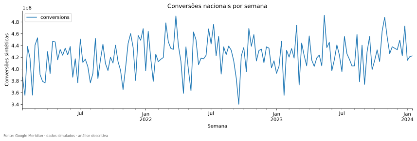

O resultado se move em torno de **423 milhões de conversões por semana**. Essa escala é uma característica da simulação, não uma estimativa de vendas de uma empresa conhecida. O menor valor está perto de 340 milhões e o maior, de 491 milhões. Há movimento suficiente para que uma semana não seja uma simples repetição da outra, mas a sequência também não conta uma história de crescimento contínuo e acentuado.

A linha ajuda a localizar acontecimentos no tempo. Para entender o que é habitual, podemos fazer outra pergunta: se juntássemos semanas de resultados semelhantes, em quais faixas haveria mais semanas? No gráfico seguinte, as barras à esquerda fazem esse agrupamento. À direita, uma caixa resume a região central, com uma linha indicando a mediana, o ponto que divide as semanas em duas metades.

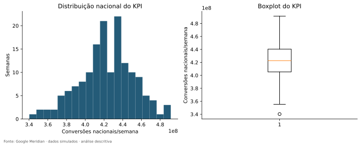

A metade central das semanas fica aproximadamente entre **405 e 440 milhões**. A proximidade entre média e mediana confirma que o centro está perto de 423 milhões, sem exigir que a distribuição seja perfeitamente simétrica. O ponto baixo destacado pelo boxplot chama atenção porque está distante desse miolo.

Um ponto distante dos demais recebe frequentemente o nome de **outlier**. Isso é uma descrição de raridade em relação a uma referência, não uma sentença de erro. A semana de 19 de setembro de 2022, que reaparecerá na revisão oficial, não deve ser apagada apenas por ser baixa. Precisamos saber qual regra a destacou, em qual escala e se existe evidência de corrupção do registro.

A série também tem oscilações rápidas que dificultam perceber mudanças lentas. O projeto calculou uma média das 13 semanas mais recentes para suavizar esse movimento. Ela usa o passado disponível, sem antecipar semanas futuras. Depois, separou uma trajetória lenta, um desenho que pode se repetir aproximadamente a cada ano e o que resta dessa separação. Essa decomposição recebe o nome de **STL**.

No próximo gráfico, os painéis mostram a série observada e essas três partes. A trajetória lenta aparece separada justamente para não confundir uma oscilação semanal com crescimento sustentado. A parte sazonal procura repetição aproximada a cada 52 semanas; o último painel guarda o que a divisão não acomodou.

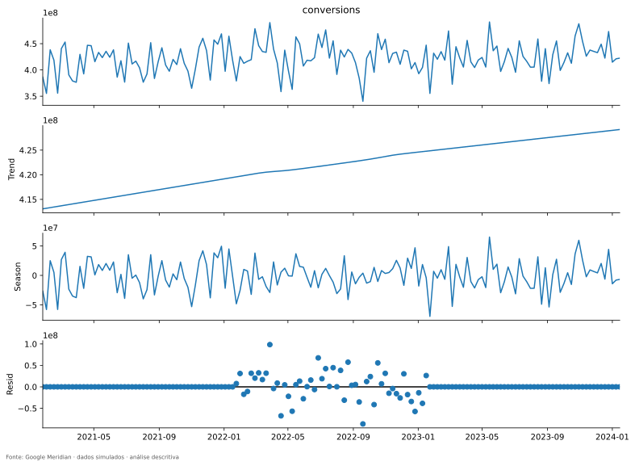

A trajetória lenta termina cerca de **3,9%** acima de onde começou. Isso descreve os extremos da curva suavizada, não a diferença entre a primeira e a última semana observadas. As medidas auxiliares da decomposição dão mais destaque ao componente sazonal que à tendência. Há, porém, somente cerca de três ciclos anuais, e um calendário civil não cabe exatamente em blocos de 52 semanas. Não podemos transformar esse desenho em uma história comprovada de festas, promoções ou hábitos de consumo.

Outra maneira de procurar repetição é comparar a série consigo mesma, deslocada no tempo. Essa semelhança recebe o nome de **autocorrelação**. A comparação com uma semana antes está perto de zero; com 52 semanas antes, também é pequena, cerca de 0,03. Isso recomenda prudência antes de declarar uma repetição anual forte. Não contradiz automaticamente a STL: separar uma curva periódica e medir uma semelhança linear em uma distância específica são operações diferentes.

A [síntese temporal](../outputs/tables/temporal_interpretation.csv) registra esses resultados, inclusive a maior mudança entre semanas consecutivas: uma queda próxima de 101 milhões em 6 de março de 2023. Não conhecemos sua causa empresarial. Temos uma localização que pode ser investigada, não uma campanha que possamos narrar.

Aprendemos que existe movimento nacional e que ele não se resume a uma tendência simples. Mas a soma eliminou os endereços. Para descobrir como esse movimento se distribui, precisamos recuperá-los.

## Capítulo 5 — O preço de somar tudo

Imagine duas regiões. Em uma, o resultado sobe; na outra, cai na mesma quantidade. O total não muda. Se guardarmos apenas esse total, a semana parecerá estável, embora tenha sido bastante diferente para cada região. Esse é um exemplo imaginado, mas expõe uma limitação real da operação que acabamos de fazer.

A visão **nacional**, ou *national-level*, preserva a evolução do conjunto. Quando mantemos uma observação para cada lugar e semana, trabalhamos em **geo-level**. Não se trata apenas de acrescentar uma coluna a uma tabela. Preservamos a possibilidade de distinguir histórias que se anulam ou se misturam na soma.

Antes de acompanhar essas histórias no tempo, vale conhecer seus tamanhos. O gráfico abaixo soma todas as semanas de cada mercado e coloca os mercados em ordem de volume acumulado. Cada barra pertence a um endereço, e sua altura responde quanto ele contribuiu para o total do período.

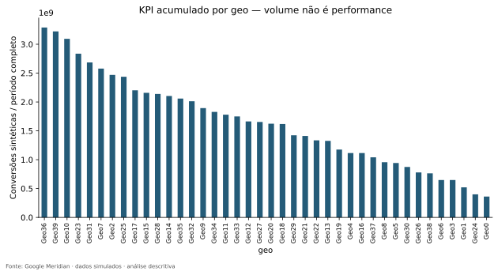

`Geo36` aparece no topo, com aproximadamente **5% do KPI acumulado**. `Geo39` vem logo depois. Existe uma diferença visível entre os maiores e os menores mercados, mas não temos um único lugar que praticamente substitua todos os outros. A [tabela por mercado](../outputs/tables/geo_kpi_summary.csv) permite conferir cada participação; a [curva de concentração](../outputs/figures/geo/kpi_concentration.svg) mostra quanto do total acumulamos ao incluir os maiores, um após outro.

Seria tentador chamar a barra mais alta de “melhor mercado”. Ainda não podemos. O gráfico mede volume, e o volume depende de quantas pessoas estão naquele lugar, entre outras coisas. Uma rede pode vender mais em um mercado maior sem que cada pessoa compre mais, e sem que sua publicidade funcione melhor ali.

A distinção importa porque queremos descobrir o que a geografia acrescenta. Se todos os mercados fossem cópias de uma mesma trajetória, multiplicadas apenas por seu tamanho, guardar os endereços nos daria uma informação diferente daquela oferecida por trajetórias realmente distintas. Precisamos examinar essa explicação simples antes de atribuir significado às diferenças.

O próximo passo, portanto, nasce da própria barra mais alta: ela é alta porque o mercado se comporta de modo particular ou porque há mais pessoas por trás dela?

## Capítulo 6 — O tamanho muda a história

Para comparar mercados, precisamos oferecer uma chance à hipótese mais simples: lugares maiores produzem volumes maiores. A população nos dá uma medida de tamanho, embora não conte tudo sobre demanda, renda ou comportamento.

No gráfico seguinte, cada ponto é um mercado. Sua posição horizontal mostra a população simulada, e a vertical, as conversões acumuladas. Se o tamanho acompanhasse pouco o resultado, os pontos não precisariam formar uma direção clara. Se mercados mais populosos concentrassem mais conversões, veríamos uma subida conjunta.

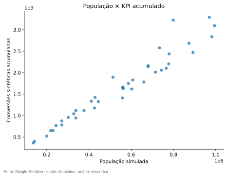

A subida é forte. Ao resumir essa associação linear, encontramos aproximadamente **0,97** em uma escala que vai de −1 a 1. Essa medida é a **correlação de Pearson**: valores positivos próximos de 1 indicam que as duas grandezas acompanham uma direção crescente muito marcada. Ela não demonstra que população seja a única explicação do resultado, mas mostra por que o ranking de volumes precisava desse contexto.

Também foi conferida a concordância dos rankings, sem exigir que a relação siga uma linha reta. Essa outra lente, chamada **correlação de Spearman**, fica próxima de 0,98. Neste caso, as duas medidas contam uma história compatível: os mercados maiores tendem a ocupar posições elevadas no resultado acumulado. Os valores completos estão na [comparação populacional](../outputs/tables/population_kpi_correlation.csv).

Para enxergar o que o volume pode esconder, passamos a comparar conversões em uma mesma base de população: quanto corresponderia a cada grupo de mil habitantes. Esse modo de olhar recebe o nome de **per capita**, aqui expresso por mil pessoas. Usamos a população de cada mercado uma vez como denominador, não a soma das 156 repetições dessa população na base.

O [ranking por mil habitantes](../outputs/figures/geo/kpi_per_capita.svg) muda a pergunta. `Geo36`, que liderava em volume total, apresenta cerca de 21,7 mil conversões simuladas por mil habitantes por semana. `Geo39` fica perto de 25,9 mil. A inversão entre esses dois mercados mostra que liderança em volume e intensidade relativa não são a mesma coisa.

Esses valores não representam a porcentagem de pessoas que comprou. Conversões não são pessoas únicas, e, nesta base, também são grandezas simuladas. Interpretar uma razão elevada como “mais de 100% dos habitantes converteram” misturaria unidades que não medem a mesma coisa.

O mesmo cuidado foi levado à mídia e ao gasto. Comparar exposição por mil habitantes ajuda a distinguir volume associado ao tamanho de intensidade relativa. Isso não altera os dados originais nem decide como o Meridian deverá recebê-los. É uma lente da investigação, não uma correção universal.

O tamanho explicou por que parte do mapa parecia tão desigual. Entretanto, ainda estamos comparando resumos de todo o período. Duas regiões podem ter médias parecidas e passar por semanas muito diferentes. Para continuar, precisamos abrir os históricos que essas médias comprimiram.

## Capítulo 7 — Cada endereço tem um histórico

Saber o tamanho médio de um mercado não revela quando ele teve semanas boas ou ruins. Para recuperar essa informação, podemos desenhar uma pequena série para cada lugar. Em vez de sobrepor quarenta linhas numa única figura, abrimos algumas histórias lado a lado.

Os painéis abaixo foram escolhidos por critérios registrados: mercados dos extremos e do centro do ranking de volume, além de extremos de oscilação relativa. Essa técnica de pequenas figuras comparáveis é conhecida como **small multiples**. O eixo do tempo é comum, mas cada painel possui sua própria escala vertical. Por isso, linhas com alturas visuais semelhantes não significam volumes semelhantes.

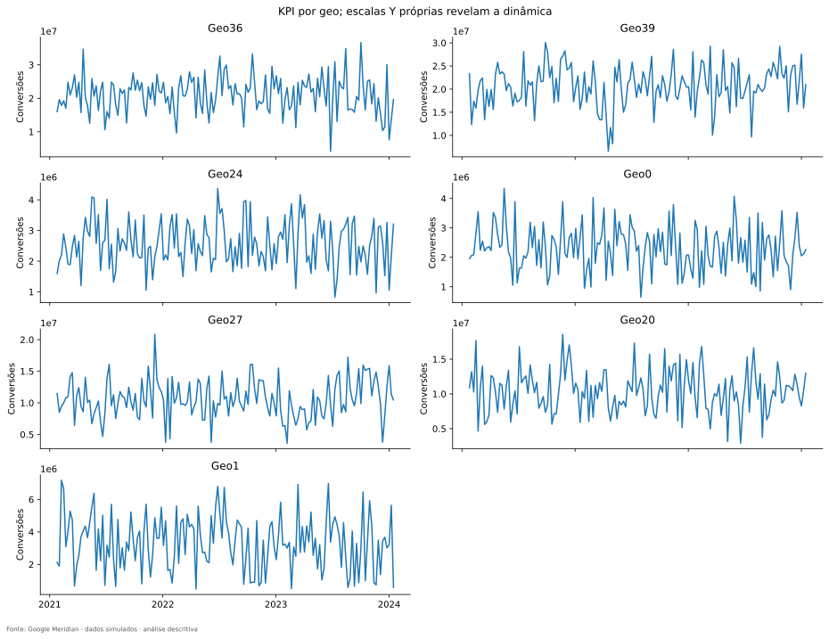

`Geo36` e `Geo39`, já conhecidos pelo volume, aparecem ao lado de mercados menores, como `Geo0` e `Geo24`. A seleção permite enxergar movimentos sem que as curvas dos menores fiquem achatadas pela escala dos maiores. Ao percorrer os painéis, interessa menos decorar a data de cada pico e mais perceber se as subidas e descidas parecem ocorrer todas juntas.

A impressão visual precisa ser conferida além dos mercados selecionados. Então comparamos os históricos de cada par de mercados. Para essa pergunta usamos a mesma ideia de correlação: agora as duas sequências são as conversões semanais de dois lugares diferentes. O [quadro completo](../outputs/figures/geo/geo_correlation.svg) cruza todos os mercados; sua diagonal compara cada um consigo mesmo e, por isso, não traz descoberta sobre sincronização.

Fora dessa diagonal existem **780 pares distintos**. A correlação mediana é aproximadamente **0,03**, e mesmo o maior valor está perto de **0,28**. A [síntese desses pares](../outputs/tables/geo_synchronization_summary.csv) mostra que não estamos diante de quarenta séries caminhando quase em perfeita sintonia. Há diferenças de dinâmica que a linha nacional não exibia.

Isso não prova que os mercados sejam independentes. Dependência pode assumir formas que uma medida linear contemporânea não captura, e a própria simulação pode conter fatores compartilhados. Também não autoriza separar os mercados em grupos comerciais inventados. O que encontramos foi mais específico: pouca sincronização linear nos históricos de conversões observados.

Agora temos duas pistas. Os mercados diferem em tamanho, e suas trajetórias não são cópias perfeitamente sincronizadas. Mas essas pistas ainda estão misturadas quando medimos a variação de todas as linhas da base. Precisamos distinguir a distância entre os mercados da mudança que acontece dentro de cada um.

## Capítulo 8 — Duas maneiras de ser diferente

Imagine primeiro uma rede em que um mercado registra sempre muito resultado e outro, sempre pouco. A tabela parecerá bastante variada quando juntarmos todas as linhas, mesmo que nada mude dentro de cada mercado. Agora imagine outra rede em que os mercados têm médias semelhantes, mas todos passam por semanas muito diferentes. Também haverá variação, só que de outra natureza.

Um modelo encontra pistas distintas nessas duas situações. Comparar um mercado permanentemente grande com outro permanentemente pequeno envolve diferenças de população e de características locais. Comparar um mercado consigo mesmo ao longo das semanas evita algumas diferenças persistentes, mas abre outras perguntas sobre o que mudou naquela semana.

A primeira fonte de diferença é chamada de **between**, porque está *entre* os mercados. A segunda é chamada de **within**, porque acontece *dentro* de cada mercado ao longo do tempo. Não são dois tipos de dados. São duas formas de olhar a dispersão das mesmas observações.

Para fazer a separação, o projeto compara as médias dos mercados entre si e, depois, as observações de cada mercado com sua própria média. A medida de dispersão usada nessa organização é a **variância**. No nosso painel completo, com os pesos adotados, essas duas parcelas recompõem a dispersão total. A explicação matemática está na [metodologia](methodology_eda.md); aqui, a ideia importante é distinguir “esse lugar costuma ser maior” de “essa semana foi diferente do habitual desse lugar”.

No gráfico abaixo, cada barra tem a mesma altura total, representando toda a variância de uma variável. A parte azul mostra as diferenças entre mercados, e a laranja, as mudanças dentro deles. Um valor de 0,8 no eixo representa 80% da variância. `conversions` é o resultado; os nomes terminados em `impression` indicam exposição e os terminados em `spend`, gasto.

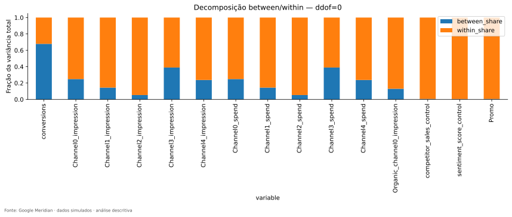

Nas conversões, aproximadamente **68%** da variação bruta está entre mercados e **32%** dentro deles. Isso combina com o que vimos: há diferenças persistentes de nível, fortemente associadas ao tamanho, mas também há semanas diferentes dentro de cada endereço.

A mídia conta outra história. Em `Channel2`, cerca de **95%** da variação de exposição está dentro dos mercados. Em `Channel3`, essa parcela é menor, aproximadamente **61%**, embora continue majoritária. Seria errado concluir que `Channel2` é o melhor canal para o modelo apenas porque apresenta um número maior. Ainda precisamos descobrir como essa variação é produzida: por mudanças graduais de intensidade, por muitos períodos zerados ou por acontecimentos compartilhados.

Esse último ponto impõe uma pausa. Suponha que todos os mercados aumentem a publicidade na mesma semana. Haverá mudança dentro de cada mercado, mas boa parte dela poderá ser vista também na série nacional. Portanto, encontrar muito *within* não responde sozinho à nossa pergunta sobre o que os endereços acrescentam.

Até aqui separamos diferenças persistentes de movimentos internos. A próxima investigação precisa separar, dentro do movimento, aquilo que acompanha o calendário comum. Só então poderemos examinar o que sobra de particular em cada combinação de lugar e semana.

## Capítulo 9 — O endereço e o calendário

Pense em alguém tentando antecipar o valor de uma ficha sem ver todas as suas colunas. Primeiro, essa pessoa recebe apenas o nome do mercado. Se cada lugar mantiver um nível característico, o endereço já ajudará bastante. Depois, fazemos outra tentativa: mostramos apenas a semana. Se muitos lugares passarem por um movimento comum naquele período, o calendário será informativo.

Podemos medir quanto cada uma dessas informações ajuda a descrever a variação observada. O resumo baseado no endereço é chamado de **R² GEO**. O resumo baseado na semana é chamado de **R² TIME**. Não estamos avaliando aqui a previsão de semanas novas; estamos descrevendo quanto das diferenças existentes acompanha as médias dos mercados ou as médias das semanas.

No gráfico seguinte, cada ponto é uma variável. Os eixos expressam frações: 0,4 corresponde a 40% da variância. Mais à direita significa maior participação das diferenças persistentes entre mercados. Mais acima significa maior participação das diferenças comuns entre semanas. Um ponto perto da origem pode variar muito: sua variação apenas não é bem resumida por essas duas informações isoladas. O gráfico usa a escala bruta, antes da divisão por população.

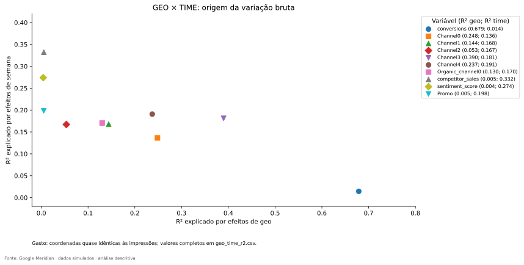

As conversões aparecem bem à direita e perto da base. Saber o mercado acompanha cerca de **68%** de sua variância bruta; saber a semana, apenas cerca de **1,4%**. Isso é compatível com diferenças importantes de nível e com a baixa sincronização que encontramos entre os históricos dos mercados.

`Channel3` também está mais à direita que `Channel2`. O primeiro tem cerca de **39%** de componente geográfico, enquanto o segundo tem aproximadamente **5%**. Os dois, porém, têm um componente temporal próximo de 17% a 18%. O posicionamento sintetiza a distinção anterior: os canais não carregam a mesma combinação de diferenças persistentes e movimentos no tempo.

Podemos dar mais um passo. Em cada ficha, retiramos o nível habitual do mercado e o movimento médio daquela semana. O que sobra é um desvio que não foi acomodado por essas duas explicações aditivas. A palavra **resíduo** designa essa sobra. Quando fazemos a retirada nas duas direções, mercado e tempo, encontramos nos arquivos a expressão **two-way**.

Para a mídia paga, sobra entre **43% e 78% da variância bruta**, dependendo do canal. Essa é uma pista importante: os registros não se resumem a um nível fixo para cada mercado mais uma mesma curva para todos. Mas ainda existe uma armadilha. Se mercados grandes reproduzem um mesmo movimento proporcional numa escala maior, uma retirada aditiva pode deixar sobras mesmo sem uma execução territorial realmente diferente em termos relativos.

É por isso que a população precisava entrar na história antes desta conclusão. Repetindo a análise por mil habitantes, a parcela geográfica persistente das mídias pagas cai para menos de **0,6%** em todos os canais. O contraste é especialmente claro em `Channel3`: de quase 39% na escala bruta para aproximadamente 0,5% na escala relativa. Boa parte da impressão de diferenças permanentes de mídia acompanha o tamanho dos lugares.

Ainda assim, na escala por habitante permanece um resíduo entre **65% e 79%** da variância de mídia paga. As [decomposições bruta](../outputs/tables/geo_time_r2.csv) e [por habitante](../outputs/tables/geo_time_r2_per_capita.csv) sustentam uma conclusão mais precisa: a diferença territorial não está principalmente em mercados com intensidades médias radicalmente distintas, mas há movimentos locais ao longo do tempo que uma única trajetória comum não descreve.

Essas porcentagens se referem à variância de cada variável em sua respectiva escala. Não são porcentagens de vendas explicadas pela publicidade. Tampouco permitem chamar toda sobra de informação útil: ela pode incluir ruído e outros fatores não medidos. O que conseguimos foi localizar uma estrutura que vale investigar.

Agora precisamos aproximar essa estrutura de algo concreto. Se o movimento de mídia não é uma simples cópia nacional, como o dinheiro foi distribuído entre canais e mercados?

## Capítulo 10 — Onde o orçamento aparece

Na abertura imaginamos alguém tentando decidir se a publicidade ajudou. Antes de avaliar uma decisão, precisamos conhecer o tamanho e a distribuição dessa decisão. Um canal que quase não recebe investimento e outro que concentra boa parte do orçamento oferecem histórias observacionais diferentes.

Somando o gasto de todo o período, `Channel3` recebe cerca de **40%** do orçamento dos cinco canais pagos. `Channel2` recebe aproximadamente **5,5%**. Os demais ficam entre esses extremos, como mostra a [participação no gasto](../outputs/figures/general/spend_share.svg). Essa diferença informa onde o dinheiro foi colocado. Não informa onde ele trouxe mais retorno.

Para recuperar os endereços do investimento, cruzamos mercados e canais. No gráfico abaixo, cada linha pertence a um mercado e cada coluna a um canal. A cor representa o gasto acumulado no período. Esse tipo de mapa de cores é chamado de **heatmap**. Não é um mapa geográfico de cidades; é uma maneira de tornar uma tabela visível.

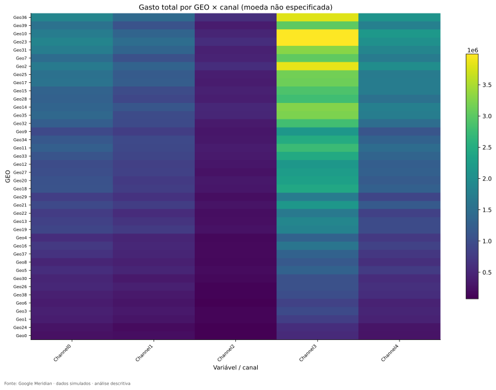

A coluna de `Channel3` ganha destaque pelo orçamento maior. As diferenças entre linhas também merecem atenção, mas já aprendemos a não interpretá-las sem considerar tamanho. As [comparações entre população e mídia](../outputs/tables/population_media_correlation.csv) mostram forte associação dos volumes acumulados com a população. O [quadro de gasto por mil habitantes](../outputs/figures/media_geo/spend_per_capita.svg) oferece a lente complementar.

Outra pergunta é se o orçamento de um canal está quase todo concentrado em poucos mercados. Neste projeto, os cinco maiores destinos de cada canal recebem, em conjunto, aproximadamente **21% a 23%** de seu gasto. Há concentração em relação a uma divisão perfeitamente uniforme, mas não uma situação em que cinco lugares absorvem quase todo o orçamento.

O projeto também condensou essa desigualdade numa medida chamada **HHI**. Sua intuição é dar mais peso a participações grandes: quanto mais o orçamento se amontoa em poucos destinos, maior fica o indicador. A [tabela de concentração](../outputs/tables/channel_geo_concentration.csv) traduz o resultado para uma distribuição equivalente por cerca de 32 a 33 mercados iguais. Isso é uma imagem da concentração, não uma redução dos nossos 40 mercados a 32 observações independentes, nem uma regra de concorrência econômica.

Ainda falta entender a relação entre dinheiro e exposição. Se dois mercados gastam a mesma quantia, podem receber quantidades diferentes de mídia. Para conferir, o projeto relacionou gasto e unidades de exposição, produzindo o **custo por unidade de mídia**, ou **CPMU**. Nesta base, a unidade é uma impressão; não é o custo por mil impressões.

Os [custos por canal](../outputs/tables/cost_per_media_unit.csv) são praticamente constantes dentro de cada canal. Por isso, seus gráficos de gasto e exposição se parecem tanto. Nas semanas sem impressões, o custo unitário fica indefinido: não houve exposição sobre a qual repartir o gasto. A ausência de um valor para essa razão não deve ser transformada em “mídia gratuita”. E, no agregado, o custo é obtido pelo gasto total em relação à exposição total, não por uma média simples de custos locais que daria o mesmo peso a volumes muito diferentes.

Temos, portanto, a dimensão do orçamento e sua ligação próxima com exposição. Mas observar a tabela de mercados e canais ainda permite duas leituras diferentes. Precisamos escolher de qual direção vamos olhar para ela.

## Capítulo 11 — O orçamento visto de duas direções

Entre em um mercado e imagine abrir apenas o orçamento dele. Quanto foi para cada um dos cinco canais? Se o mercado fosse maior e todo seu orçamento dobrasse, mantendo as proporções, a resposta continuaria igual. Estamos perguntando pela composição interna, não pelo tamanho.

Essa composição é o **media mix**. No gráfico abaixo, cada barra representa todo o orçamento de um mercado e suas partes mostram como ele foi dividido. As barras têm a mesma altura porque todas representam 100% do respectivo orçamento, mesmo quando os valores monetários são muito diferentes.

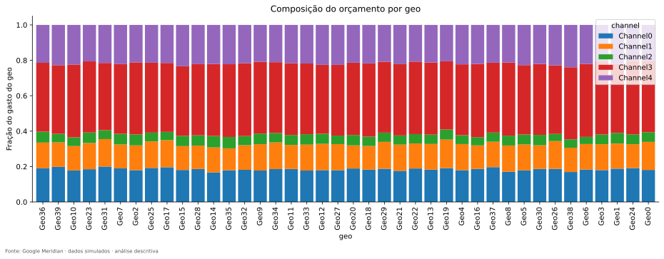

As barras são parecidas. `Channel3` ocupa aproximadamente 38% a 41% do orçamento de cada mercado; `Channel2`, cerca de 4% a 6,5%. A maior distância entre a menor e a maior participação territorial de um canal ocorre em `Channel1`: **3,74 pontos percentuais**. Dizer pontos percentuais é necessário porque estamos subtraindo participações, não calculando um crescimento relativo.

Essa descoberta freia uma interpretação fácil. Temos quarenta mercados, mas os orçamentos acumulados não revelam quarenta composições radicalmente diferentes. O [gráfico de desvios do mix nacional](../outputs/figures/media_geo/mix_deviations_pp.svg) ajuda a enxergar as pequenas diferenças sem exagerá-las. A [síntese por canal](../outputs/tables/channel_geo_interpretation.csv) registra seus intervalos e relaciona a leitura à população.

Agora saia desse mercado e acompanhe um único canal. De todo o dinheiro investido nele, quanto foi para cada endereço? Mudamos o total de referência: antes era o orçamento do mercado; agora é o orçamento do canal. Essa segunda leitura é a **alocação geográfica**, ou **geo allocation**.

Pense num exemplo hipotético com apenas dois mercados. O maior pode ter dez vezes o orçamento do menor, e ambos podem destinar metade ao mesmo canal. Eles têm o mesmo mix, mas o maior absorve uma parcela muito maior do dinheiro total desse canal. Não há contradição: as perguntas são diferentes.

O [heatmap de alocação](../outputs/figures/media_geo/geo_allocation.svg) faz essa segunda leitura. Para conferir sua lógica, somamos as participações de um canal ao longo dos mercados e chegamos ao total desse canal. No [mix](../outputs/tables/media_mix.csv), a composição se fecha dentro de cada mercado; na [alocação](../outputs/tables/geo_allocation.csv), a distribuição se fecha dentro de cada canal. Não precisamos de fórmulas para lembrar a distinção: primeiro escolhemos o orçamento cuja divisão queremos conhecer.

A semelhança do mix acumulado não encerra a investigação. Dois mercados podem terminar três anos com composições parecidas e ter distribuído os anúncios em semanas completamente diferentes. Tudo que somamos ao longo do período apagou o calendário. Para entender a variação local encontrada antes, precisamos devolvê-lo ao mapa de mídia.

## Capítulo 12 — O calendário dos canais

Imagine um calendário em que cada linha pertence a um mercado. As colunas são semanas, e cada quadrado mostra a intensidade de exposição naquele lugar e momento. Uma faixa vertical pode indicar uma semana movimentada em vários mercados; uma faixa horizontal persistente, um lugar que costuma ter intensidade maior. Blocos localizados sugerem movimentos restritos a partes do painel.

Começaremos por `Channel2`, que tinha pouca participação no orçamento e muita variação dentro dos mercados. O gráfico usa exposição por mil habitantes, para que o tamanho populacional não domine a leitura. As cores próximas ao extremo inferior da escala incluem os zeros; apenas a tabela permite distinguir exatamente zero de um valor positivo pequeno.

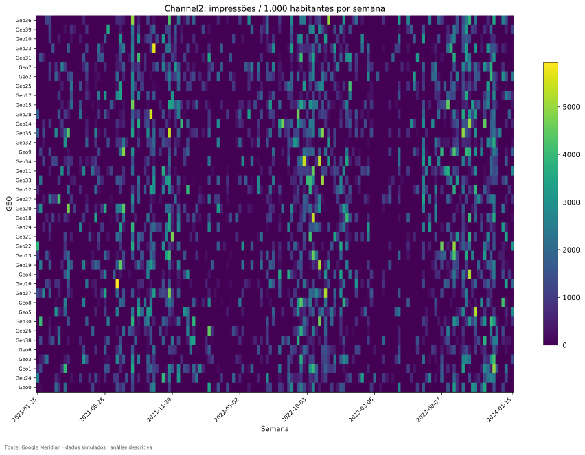

O calendário é marcado por interrupções. Conferindo as células, **64,3% das combinações de mercado e semana não têm exposição desse canal**. Mesmo assim, todos os 40 mercados receberam `Channel2` em algum momento. Estar presente em todos os mercados ao longo de três anos é muito diferente de estar presente em todos eles em cada semana.

Também seria enganoso olhar apenas para as semanas nacionais zeradas. Existem somente quatro: 26 de abril de 2021, 25 de julho de 2022, 15 de maio de 2023 e 19 de junho de 2023. Nas outras, basta algum mercado ter exposição para o total nacional ser positivo. Assim, a linha nacional esconde grande parte das ausências locais.

Quando muitos registros ficam em zero, dizemos que o sinal é **esparso**, ou usamos o termo inglês **sparsity**. Não é um defeito automático. Alternar presença e ausência pode oferecer contrastes interessantes. Mas precisamos de períodos observados suficientes, e a razão de a mídia ter aparecido em cada lugar continua desconhecida. Uma alternância registrada não equivale a um experimento aleatório.

Em `Channel2`, cada mercado esteve ativo em aproximadamente **28% a 44% das semanas**, e a maior sequência local sem exposição chegou a **27 semanas**. Esses detalhes, disponíveis no [estudo de atividade](../outputs/tables/activity_intensity_summary.csv) e nas [sequências](../outputs/tables/activity_runs.csv), ajudam a entender por que uma futura janela de avaliação pode ter pouco contato com o canal.

Para perceber o contraste, olhemos `Channel3` com a mesma organização de linhas e semanas. A escala de cores é própria deste gráfico: uma cor igual nos dois painéis não garante a mesma quantidade de impressões. O que podemos comparar diretamente é a distribuição do movimento e da atividade.

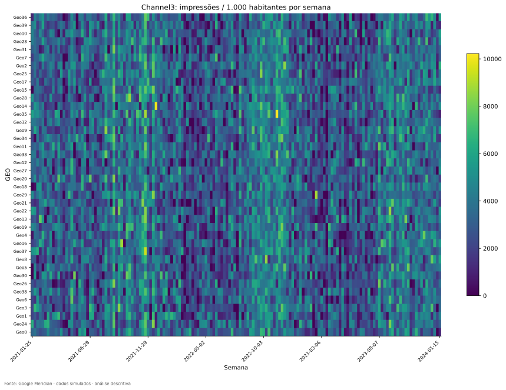

Aqui a presença é muito mais contínua: somente **2,7% das células** estão zeradas, e há uma sequência local de até **127 semanas ativas**. Nenhum desses resultados determina qual canal é melhor. Eles mostram que os dois oferecem tipos diferentes de comparação ao longo do tempo.

A diferença também esclarece uma ambiguidade da palavra “variar”. Um canal pode variar porque alterna zero e exposição positiva ou porque muda bastante de intensidade mesmo quando já está ativo. Para separar as duas situações, o projeto examinou a dispersão nas semanas positivas e a alternância entre presença e ausência.

Uma medida usada nessa comparação coloca a oscilação em relação ao nível médio: o **coeficiente de variação**, ou **CV**. Em `Channel2`, a mediana do CV dos mercados é aproximadamente 1,88 quando incluímos todas as semanas, mas cai para 0,81 quando olhamos somente as semanas ativas. Há variação de intensidade, porém boa parte da impressão inicial de oscilação vinha da entrada e saída de atividade.

A decomposição específica confirma isso: aproximadamente **metade da variância dentro dos mercados** de `Channel2` corresponde ao componente de alternância zero/positivo. Em `Channel3`, esse componente fica perto de **10,5%**. São parcelas da variação *within*, não do resíduo após retirar também as semanas comuns, e muito menos parcelas de conversões causadas pelos canais.

Uma revisão da EDA aprofundou esse ponto justamente porque o percentual de zeros sozinho não respondia à pergunta. Também corrigiu a ordenação dos mercados após a divisão por população, para permitir acompanhar o mesmo endereço entre os painéis. Uma linha trocada poderia parecer uma descoberta territorial; manter os endereços comparáveis faz parte de ler corretamente a imagem.

Agora conseguimos descrever onde e quando a mídia aparece. Falta uma questão que os calendários de um canal por vez não resolvem: quando um se movimenta, os outros fazem o mesmo?

## Capítulo 13 — Sinais que caminham juntos

Até aqui abrimos cada canal como se ele tivesse uma história própria. Mas o calendário de um pode acompanhar o de outro. Se isso acontecer, uma semana de muita exposição em um canal será também uma semana de muita exposição em outro. Antes de relacionar qualquer um deles ao resultado, precisamos saber quanto seus movimentos se parecem.

Como gasto e impressões são quase proporcionais dentro de cada canal desta base, começar destacando essa correlação próxima de um seria pouco informativo. Estaríamos redescobrindo o custo unitário quase constante. A pergunta mais útil envolve sinais distintos, como as exposições de `Channel2` e `Channel3`.

No total nacional, a correlação de Pearson entre eles é aproximadamente **0,70**. É uma associação positiva relevante: semanas de maior exposição em um tendem a acompanhar maior exposição no outro. Mas já sabemos que a soma pode esconder diferenças. Por isso, a análise foi repetida com quatro formas de organizar a informação.

A primeira é o nacional, com um ponto por semana. A segunda mantém todas as fichas de mercado e semana em seus valores brutos; nos arquivos, ela aparece como *overall*. A terceira compara desvios em relação ao nível habitual de cada mercado, a visão *within*. A quarta retira também o movimento médio semanal, a visão *two-way* que conhecemos no capítulo do endereço e do calendário.

Para `Channel2` e `Channel3`, a correlação passa de **0,70 no nacional** para cerca de **0,52 no painel bruto**, **0,50 dentro dos mercados** e **0,45 após retirar também o movimento comum das semanas**. A associação não desaparece, mas sua força muda com a pergunta. Esse percurso é mais informativo do que escolher um único número e tratá-lo como propriedade universal dos canais.

A [comparação dos pares](../outputs/tables/substantive_pair_comparison.csv) permite acompanhar essas mudanças. Para enxergar várias relações ao mesmo tempo, usamos uma matriz de cores. No gráfico abaixo, cada encontro de linha e coluna é a correlação entre duas variáveis depois de retirar os níveis médios dos mercados e das semanas. A escala vai de relações negativas a positivas. A diagonal compara uma variável consigo mesma, e os pares de gasto e exposição do mesmo canal são quase repetições contábeis; nenhum desses casos deve dominar a leitura.

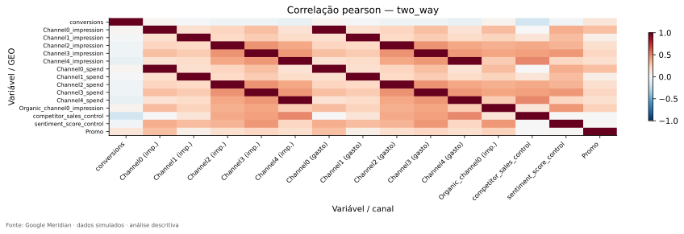

Uma leitura substantiva procura o que sobra entre personagens diferentes. Além de `Channel2` e `Channel3`, existe associação entre `Channel4` e `competitor_sales_control`, perto de **0,48** nessa escala. Isso não demonstra que um concorrente tenha provocado uma decisão publicitária real. Mostra que um índice incluído para representar outro aspecto do ambiente acompanha parte da mídia na simulação.

Os controles, portanto, não são figurantes que podemos acrescentar automaticamente. `competitor_sales_control` e `sentiment_score_control` variam, assumem valores positivos e negativos e não são medidas monetárias de vendas ou satisfação. `Promo` também varia, mas tem outra forma: aproximadamente **47% dos registros são zero**, com valores contínuos no restante. Uma regra que pressupusesse apenas “houve promoção” e “não houve promoção” perderia informação que existe na coluna.

Os [perfis dos controles](../outputs/tables/control_detailed_profile.csv) e suas [relações com os demais sinais](../outputs/tables/control_relationship_review.csv) tornam essas distinções verificáveis. Um controle próximo de zero em média não deve ser chamado de “muito volátil” só porque dividir sua dispersão por essa média produz um número enorme. Para esses índices, observamos amplitude, dispersão e mudanças em sua própria escala.

A história ganhou companhia: mídia, controles e tratamento podem caminhar juntos. Isso torna especialmente delicada a próxima pergunta. Se um canal acompanha o resultado, de quem é o movimento que estamos vendo?

## Capítulo 14 — A associação muda quando mudamos a pergunta

Voltemos à empresa da abertura. Se publicidade e conversões aumentam ao mesmo tempo, podemos querer concluir que uma produziu a outra. Mas a empresa também pode aumentar a publicidade porque já esperava mais demanda. Nesse caso, a expectativa sobre o resultado participa da decisão de investir. A direção da história é mais complicada que “anúncio primeiro, resultado depois”.

Há também fatores compartilhados. Uma época de maior procura pode elevar as conversões e motivar mais anúncios. Selecionar mercados com maior demanda esperada pode associar mídia e resultado mesmo antes de qualquer efeito da campanha. Em marketing, essa escolha direcionada de público ou mercado costuma ser chamada de *targeting*. A base não informa decisões comerciais reais que permitam reconstruir esse mecanismo; os exemplos explicam por que precisamos ter cuidado, não o que comprovadamente aconteceu aqui.

O próprio projeto oferece um exemplo numérico forte dessa cautela. Se juntarmos os valores brutos de todos os mercados e semanas, a exposição de `Channel3` tem correlação aproximada de **0,47 com as conversões**. Parece uma relação positiva bastante diferente daquela vista quando comparamos cada mercado com seu próprio histórico: nessa segunda visão, a correlação fica perto de **−0,05**.

Depois de retirar também as médias semanais, ela permanece próxima de zero, em torno de **−0,046**. Já no agregado nacional fica perto de **−0,12**. A [comparação entre mídia e KPI](../outputs/tables/predictor_kpi_comparison.csv) registra as quatro lentes. O resultado não permite decidir que o canal funciona no painel e deixa de funcionar no nacional. Permite perceber que relações entre níveis absolutos e relações entre mudanças são perguntas distintas.

Lembre-se do tamanho populacional. Mercados maiores tendem a ter mais exposição e mais conversões. Uma associação entre esses volumes pode ser forte mesmo quando as semanas de exposição acima do habitual não acompanham aumentos semelhantes de conversões. Retirar médias ajuda a investigar essa diferença, mas não controla automaticamente todos os fatores que mudam dentro de um mercado.

Também não seria correto concluir que a publicidade reduz conversões por causa de uma correlação negativa pequena. Efeitos podem ocorrer com atraso, depender da quantidade de exposição ou se misturar a decisões tomadas em antecipação à demanda. Uma correlação contemporânea simples não separa essas possibilidades.

Para explorar o atraso, o projeto comparou mídia de semanas anteriores com o KPI atual, deslocando a exposição de zero a oito semanas. Esse deslocamento recebe o nome de **lag**, ou defasagem. A [figura das defasagens](../outputs/figures/relationships/lags.svg) e a [tabela correspondente](../outputs/tables/exploratory_lags.csv) mostram essas associações, com menos pares disponíveis quando o deslocamento aumenta.

Essas curvas não escolhem quanto tempo a publicidade permanece atuando. Escolher o maior ponto e chamá-lo de “duração do efeito” converteria uma exploração de associações em uma conclusão que ela não sustenta. O que sabemos é onde os sinais se aproximam ou se afastam sob diferentes comparações.

Agora a dificuldade da pergunta inicial ficou mais concreta. Não basta haver movimento. Precisamos conseguir distinguir histórias concorrentes para esse movimento. Dois canais que acompanham um ao outro e fatores que acompanham ambos podem permitir explicações muito parecidas para o mesmo resultado.

## Capítulo 15 — O problema das duas torneiras

Imagine uma piscina abastecida por duas torneiras. Se ambas forem abertas e fechadas sempre juntas, podemos observar a água subir, mas teremos dificuldade para descobrir quanto veio de cada uma. Se em alguns momentos uma mudar enquanto a outra permanece estável, ganharemos uma comparação que antes não existia.

Com os canais de mídia acontece algo semelhante. Observar separadamente cada exposição não basta se suas mudanças forem quase sempre as mesmas. Para distinguir seus papéis, o modelo precisa de diferenças informativas entre os sinais, além de hipóteses que liguem essas diferenças ao resultado. Esse desafio está relacionado à **identificabilidade**: a possibilidade de distinguir explicações ou parâmetros a partir das informações e das hipóteses disponíveis.

A analogia das torneiras cobre apenas parte do problema. Na empresa, alguém pode abrir uma torneira porque prevê uma mudança na procura, e pode haver fatores relevantes que nem sequer foram medidos. Assim, separar numericamente dois sinais é necessário em algumas situações, mas não resolve sozinho a interpretação causal.

Uma dificuldade específica ocorre quando uma variável pode ser muito bem reconstruída por uma combinação das outras. Ela pode existir mesmo sem um par isolado apresentar correlação perfeita. Esse padrão é chamado de **multicolinearidade**. Precisamos, portanto, olhar o conjunto de sinais, não apenas comparar dois de cada vez.

Para isso, o projeto usou o **VIF**, um indicador que investiga quanto a redundância linear pode aumentar a incerteza de um coeficiente em uma regressão linear. A lógica é tentar explicar cada preditor usando os demais e verificar quanto de informação própria resta. O diagnóstico não é um veredito sobre o efeito de mídia nem um resumo completo do futuro modelo.

No gráfico abaixo, cada linha é um preditor e as colunas correspondem às quatro lentes que já usamos. A cor usa uma escala comprimida: cada aumento de uma unidade nessa escala representa multiplicar o VIF por dez. Essa transformação é o logaritmo de base dez, indicado no título. Assim, o valor da barra de cores não deve ser lido como o VIF original. Os números originais estão na [tabela de VIF](../outputs/tables/vif_summary.csv).

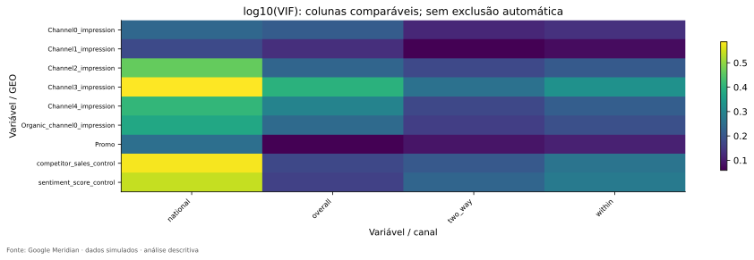

Os máximos são aproximadamente **3,86 no nacional**, **2,48 no painel bruto**, **2,11 na visão within** e **1,80 na two-way**. Nesse conjunto de variáveis e nessas transformações, não encontramos redundância linear extrema. Isso é uma evidência favorável para continuar a investigação, mas não uma certificação de que todos os efeitos poderão ser separados com precisão.

O conjunto diagnosticado inclui exposições pagas e orgânica, os dois controles e `Promo`. Não inclui o KPI como preditor e não duplica gasto e impressão do mesmo canal. Essa escolha importa porque, com custo quase constante, incluir ambos criaria artificialmente o problema que estaríamos tentando medir.

A futura modelagem poderá mudar os sinais. Um anúncio pode continuar associado à resposta depois da semana em que foi exibido; representar essa persistência é a ideia de **adstock**. E aumentar exposição pode trazer acréscimos progressivamente menores de resposta; essa é a ideia de **saturação**. Ao transformar os canais para representar essas possibilidades, também podemos alterar suas relações e sua redundância.

Por isso, o VIF atual não libera automaticamente a modelagem, e um valor elevado não manda remover um canal. Temos um diagnóstico sobre os sinais explorados. Devemos carregá-lo como pergunta para a próxima fase: depois das escolhas de modelagem, ainda haverá informação suficiente para distinguir os papéis propostos?

Antes de juntar as conclusões, resta confrontar nossa investigação com outra leitura: a que o próprio Meridian oferece para examinar os dados e uma especificação provisória.

## Capítulo 16 — Uma segunda opinião

A exploração até aqui foi construída em torno das dúvidas do TCC. O Meridian possui seus próprios diagnósticos padronizados. Consultá-los permite comparar a investigação personalizada com a forma como a ferramenta enxerga os dados que receberia. Não substitui nosso raciocínio; acrescenta uma segunda opinião que também precisa ser interpretada.

A execução registrada no repositório utilizou **Meridian 2.1.0**, em uma versão do código identificada nos metadados. Foram aplicadas **13 checagens**, que produziram **16 achados**: dez classificados como `INFO` e seis como `REVIEW`. A segunda classificação pede revisão. A primeira não significa que todas as questões metodológicas estejam resolvidas.

Quatro dos seis alertas envolvem extremos ou variabilidade, em conversões e em outros sinais, tanto por mercado quanto no nacional. Os outros dois envolvem custo por unidade de mídia. Todos foram examinados na revisão posterior à auditoria. A [tabela de resolução](../outputs/tables/official_review_resolution.csv) preserva localização, motivo, decisão e limite restante; o nome `REVIEW` não foi apagado para fazer o resultado parecer melhor.

Vale acompanhar um caso concreto. Na triagem personalizada, `Geo36` em 14 de agosto de 2023 aparece com cerca de **34,9 milhões de conversões** e é sinalizado pela regra aplicada aos valores brutos de todo o painel. Quando a referência passa a ser a escala por habitante ou o histórico do próprio mercado, ele não é sinalizado pela respectiva regra. O valor não mudou; mudou o grupo com o qual foi comparado. Isso ensina por que “extremo” precisa sempre vir acompanhado de uma referência.

Já `Geo23` em 28 de fevereiro de 2022 permanece sinalizado nas três comparações da [revisão de casos](../outputs/tables/outlier_case_review.csv). Não foi simplesmente absolvido pela população. Ainda assim, não temos evidência de erro de registro nem contexto empresarial que justifique substituí-lo. A decisão documentada foi preservar os dados simulados e reservar a avaliação de influência no ajuste para a modelagem. Preservar é uma decisão fundamentada, não uma afirmação de que o ponto jamais importará.

A regra baseada na distância à parte central da distribuição aparece nos arquivos como **IQR**. Outra triagem utiliza a distância à mediana e uma medida robusta de dispersão, chamada **MAD**. Elas ajudam a localizar registros para investigação. Não são detectores infalíveis de erro, especialmente diante de muitos zeros ou mercados de tamanhos diferentes. A revisão olhou também o entorno temporal dos casos, sem atribuir a seus picos eventos comerciais inventados.

O custo unitário oferece uma lição diferente. A variação é tão pequena que uma regra baseada em dispersão também muito pequena pode sinalizar desvios microscópicos. Entre os casos geográficos revisados, o maior desvio relativo na respectiva série é da ordem de **0,000014%**. Isso é compatível com precisão numérica de geração ou exportação, embora a causa não tenha sido comprovada. Não há suporte para narrar uma oscilação econômica importante de preço. O dado e o limite oficial foram preservados.

Outra parte da segunda opinião exige comparar coisas equivalentes. O Meridian transforma variáveis e calcula alguns diagnósticos em escalas diferentes das nossas tabelas brutas. Seus R² também recebem um ajuste estatístico. No agregado nacional, controles e `Promo` são somados por padrão nessa checagem oficial, enquanto a exploração personalizada usa médias ponderadas por população. Se ignorássemos essas escolhas, poderíamos chamar uma diferença de definição de erro de cálculo.

A revisão, por isso, refez R², correlações e VIF nas mesmas escalas oficiais e conferiu as localizações dos casos extremos. As [reconciliações](../outputs/tables/official_r2_reconciliation.csv) e os arquivos associados no apêndice documentam a concordância numérica e as diferenças de pergunta. Os limites oficiais de correlação e VIF são voltados a situações extremas; passar por eles não garante que uma associação moderada seja irrelevante para nosso estudo.

Há ainda uma possível confusão no relatório HTML. Para seus diagnósticos, a ferramenta gerou amostras de suposições iniciais sobre o modelo, antes de aprender os efeitos a partir dos dados. Essas suposições recebem o nome de **prior**. O resultado de atualizar essas suposições com os dados seria uma distribuição **posterior**. Nesta etapa não houve essa estimação posterior. Logo, encontrar gráficos sobre a prior não significa que os efeitos publicitários já foram estimados.

O [relatório oficial](../outputs/reports/meridian_eda_report.html) deve ser baixado e aberto no navegador para sua leitura completa. A configuração usada é provisória. Inclusive a razão entre registros e a contagem de parâmetros adotada pela checagem, próxima de 30,6, é apenas um sinal de adequação sob aquela configuração. Não transforma 6.240 fichas dependentes em 6.240 experiências independentes.

A segunda opinião não encerrou nossas perguntas com um selo de aprovação. Ela tornou as ressalvas localizáveis e comparáveis. Agora podemos reunir as pistas sem esconder os pontos que ainda exigirão cuidado.

## Capítulo 17 — O que cada pista acrescentou

No começo tínhamos uma planilha e uma pergunta sobre publicidade. Agora conseguimos reconstruir por que cada investigação foi necessária. Verificar a estrutura nos impediu de confundir buracos com inatividade. Olhar o país inteiro mostrou que o resultado muda. Abrir os endereços mostrou diferenças de volume, e considerar população revelou o quanto essas diferenças acompanham tamanho.

Acompanhando os mercados no tempo, percebemos que suas histórias não são perfeitamente sincronizadas. Separar diferenças persistentes de mudanças internas nos ajudou a localizar a variação. Retirar também os movimentos comuns das semanas tornou a pergunta mais exigente. Repetir a análise por habitante evitou que a escala populacional fosse tomada automaticamente como execução territorial distinta.

O orçamento acumulado trouxe uma surpresa útil: os mercados têm composições relativamente semelhantes entre canais. Se tivéssemos parado ali, poderíamos ter subestimado as diferenças semanais. Os calendários mostraram que chegar a proporções parecidas no fim do período não significa fazer as mesmas coisas nos mesmos lugares e momentos.

`Channel2` concentrou essa descoberta. Sua parcela pequena do gasto, muitos zeros e longas interrupções locais explicam por que um grande componente de variação não é uma promessa simples de informação abundante. Antes de modelá-lo, será importante conferir se os períodos escolhidos para aprender e avaliar o modelo contêm exposição suficiente. A decisão não é excluir o canal; é tornar explícito o que podemos aprender em cada janela.

`Channel3` oferece o contraste: grande parcela do orçamento, atividade quase contínua e forte componente geográfico bruto que cai ao considerar população. Ele também acompanha `Channel2` em parte de seus movimentos. Esses fatos precisam ser lidos juntos. Nem o maior orçamento demonstra maior retorno, nem uma correlação moderada impede automaticamente separar os sinais.

Os outros canais completam a história sem exigir três novos capítulos iguais. `Channel0` e `Channel1` também têm componentes geográficos brutos que diminuem bastante na escala por habitante e apresentam associação com o índice de sentimento. `Channel4` mantém uma relação relevante com o índice de concorrência mesmo depois de retirar as médias geográficas e temporais. Os [resumos integrados](../outputs/tables/channel_integrated_review.csv) e as [ações de prontidão](../outputs/tables/readiness_actions.csv) registram o que esses achados exigem examinar, sem escolher controles ou efeitos pela correlação.

Depois de percorrer esse caminho, podemos reconhecer cinco perguntas que organizaram a investigação. A primeira era se podíamos confiar estruturalmente nos dados: o painel completo e as verificações de domínio sustentam essa confiança delimitada, sem certificar plausibilidade comercial. A segunda era se existia movimento no tempo: encontramos variação em resultado, mídia e outros sinais, com formas diferentes de atividade e oscilação.

A terceira perguntava se os mercados eram diferentes. Sim, mas a resposta exigiu separar volume de intensidade e reconhecer o papel da população. A quarta perguntava se acompanhar mercado, tempo e mídia juntos revelava algo além do nacional. Os desvios locais e os calendários mostram que essa estrutura existe, inclusive na escala por habitante. A quinta perguntava se alguns sinais poderiam ser difíceis de separar. As associações entre canais e controles colocam essa questão, enquanto o VIF não indica redundância linear extrema no conjunto examinado.

Essas cinco respostas não são cinco autorizações independentes para ajustar qualquer modelo. Elas se condicionam. Ter uma base completa não resolve a falta de atividade em uma janela. Ter variação não determina se ela foi causada por publicidade. Ter VIF moderado não transforma o passado observado em um experimento.

Com essas distinções, finalmente estamos preparados para formular a pergunta técnica que teria sido prematura no início.

## Capítulo 18 — O que a geografia realmente acrescentou?

Podemos agora condensar a investigação: **a base contém informação geotemporal adicional, potencialmente útil para distinguir os componentes de um MMM geo-level, além da informação temporal de uma série nacional agregada?**

Cada parte dessa pergunta já ganhou significado. Informação geotemporal é aquilo que varia conforme o lugar e a semana. Preservar o nível geográfico significa manter o endereço das fichas. Distinguir componentes é o problema das torneiras, que exige variação informativa e hipóteses adequadas. A palavra “potencialmente” reconhece a distância entre encontrar estrutura nos dados e demonstrar que um modelo consegue aproveitá-la.

A resposta descritiva é **sim, com ressalvas**. O painel guarda movimentos locais que não podem ser reconstruídos a partir dos totais nacionais. Na decomposição, os desvios locais depois de retirar médias de mercado e semana se compensam quando agregados em cada semana. A soma perde justamente a distribuição interna desses desvios. A geografia permite observá-la.

A conclusão fica mais convincente porque não depende apenas dos volumes brutos. Depois de considerar população, o componente persistente de exposição entre mercados fica muito pequeno, mas permanecem diferenças relevantes de lugar e tempo. Também encontramos baixa sincronização linear do KPI entre mercados e calendários de atividade diferentes. São pistas complementares, não uma única métrica escolhida para produzir uma resposta favorável.

Ao mesmo tempo, não seria correto contar que cada região possui uma estratégia de orçamento radicalmente própria. Os mixes acumulados são semelhantes. A informação adicional observada está mais na dinâmica e na distribuição semanal do que em grandes contrastes permanentes de composição. E a intermitência de `Channel2` mostra que parte da variação precisa ser interpretada em termos de oportunidades observadas, não apenas de sua magnitude.

O que ainda não demonstramos é a utilidade efetiva dessa informação para estimar efeitos ou prever novos períodos. A sobra pode conter ruído, fatores não observados e decisões de mídia relacionadas à demanda. Um modelo nacional pode ser uma referência útil, e um modelo geográfico pode aproveitar diferenças locais ou apenas ganhar complexidade. Precisaremos compará-los para saber.

Um modelo que permite diferenças entre mercados e, ao mesmo tempo, compartilha informação entre eles é chamado de **hierárquico**. A ideia é evitar tanto fingir que todos são idênticos quanto tratá-los como quarenta universos sem relação. Essa possibilidade faz sentido investigar diante do painel que conhecemos. Ainda não foi testada por estimação de efeitos nesta EDA.

Portanto, a geografia acrescentou algo concreto: devolveu os endereços, separou volume de intensidade, revelou calendários locais e mostrou como as associações mudam quando acompanhamos os mercados por dentro. O próximo trabalho é descobrir quanto disso o modelo pode usar com confiabilidade. Essa é uma pergunta nova, sustentada pela investigação atual, e não uma conclusão que possamos antecipar.

## Epílogo — Voltar à pergunta certa

Voltemos à pessoa diante da planilha de publicidade. Ela queria saber se os anúncios ajudaram. Depois desta investigação, ainda não podemos entregar uma lista dos melhores canais. Mas podemos explicar por que olhar apenas o dinheiro gasto e o resultado nacional seria insuficiente, e quais comparações os dados permitem construir.

Não sabemos quantas conversões aconteceram por causa da mídia e não teriam acontecido sem ela. Esse acréscimo contrafactual é a ideia de **incrementalidade**. Também não estimamos o retorno atribuível ao investimento, chamado de **ROI**, nem o retorno esperado de uma unidade adicional de gasto, chamado de **mROI**. Sem esses passos e suas hipóteses, não temos base para recomendar um orçamento ótimo.

A EDA nos deu algo anterior: uma descrição verificável do terreno. Sabemos onde os dados estão completos, como os resultados se movem, quanto o tamanho dos mercados participa dos volumes e onde as exposições entram e saem. Sabemos que alguns sinais acompanham outros e que mudanças de escala alteram a leitura. Sabemos também onde os diagnósticos localizaram pontos que continuarão merecendo atenção.

A próxima fase deverá explicitar o que supomos sobre as relações entre demanda, controles, publicidade e resultado. Deverá escolher formas de representar persistência e saturação, justificar as suposições iniciais e avaliar se os dados conseguem atualizá-las de maneira informativa. Os cuidados específicos por canal e controle já estão registrados; não precisamos começar essa decisão às cegas.

Para comparar modelos, será necessário reservar períodos que não sejam usados no ajuste e verificar o comportamento neles. Essa avaliação em dados separados é chamada de validação **fora da amostra**; a parcela reservada costuma receber o nome de **holdout**. Usar períodos comparáveis para as versões nacional e geográfica evita que uma pareça melhor apenas por ter recebido uma tarefa mais fácil. Ainda será preciso examinar incerteza e estabilidade: prever bem, por si só, não comprova atribuição causal correta.

Há uma pendência prática distinta dessas decisões científicas. O repositório registra execução local dos notebooks, mas a validação em uma sessão real do serviço Google Colab continua pendente. Executar localmente as células não comprova o funcionamento da interface e do ambiente do Colab. O [registro dessa pendência](COLAB_VALIDATION.md) explica o que precisa ser feito para encerrá-la.

Esta reescrita organiza e interpreta os resultados já existentes; não representa uma nova execução da EDA nem um ajuste do MMM. Os dados são simulados, e não conhecemos campanhas ou decisões reais por trás dos desenhos observados. Essas fronteiras fazem parte do que aprendemos, não diminuem o valor da investigação.

Começamos com um total nacional que escondia seus endereços. Recuperá-los não nos deu a resposta final sobre publicidade. Deu-nos a capacidade de formular a próxima pergunta com mais precisão: entre as diferenças que agora conseguimos enxergar, quais podem sustentar uma explicação confiável dos efeitos de mídia? É sobre esse terreno conhecido que o modelo poderá ser construído.

---

## Apêndice A — Como voltar às evidências

A história termina no epílogo. Os apêndices servem para quando você quiser conferir um número, abrir um gráfico em tamanho maior ou acompanhar a execução. Não é preciso lê-los antes dos capítulos.

O repositório funciona como o arquivo da investigação. Em `data/raw/` está a matéria-prima preservada; em `data/processed/`, a cópia organizada para análise; em `data/metadata/`, a origem e os registros de versão. Os notebooks mostram a investigação sendo executada, enquanto `src/` reúne as ferramentas reutilizadas por eles. Figuras, tabelas e relatórios ficam respectivamente em `outputs/figures/`, `outputs/tables/` e `outputs/reports/`. Os registros de execução ficam em `outputs/logs/`, e `docs/` guarda a memória metodológica e interpretativa.

Os testes em `tests/` verificam regras importantes e casos que já produziram problemas. Funcionam como detectores: ajudam a avisar quando algo quebra, mas não provam sozinhos que toda interpretação científica está correta. Os scripts e as dependências da raiz organizam a execução; o [README](../README.md) explica esse caminho.

| Quero entender… | Onde procurar |
|---|---|
| A origem dos dados | [Metadados da fonte](../data/metadata/source.json) e [dados originais](../data/raw/geo_all_channels.csv) |
| A estrutura de uma linha | [Dicionário](data_dictionary.md) e [painel preparado](../data/processed/geo_time_panel.csv) |
| A qualidade do painel | [Auditoria estrutural](../outputs/tables/data_audit.csv) e [ausências por variável](../outputs/tables/missing_summary.csv) |
| O KPI nacional | [Série nacional](../outputs/tables/national_timeseries.csv) e [estatísticas](../outputs/tables/national_descriptive.csv) |
| O comportamento temporal | [Síntese temporal](../outputs/tables/temporal_interpretation.csv), [STL](../outputs/tables/kpi_stl_52.csv) e [autocorrelação](../outputs/tables/kpi_acf.csv) |
| As diferenças geográficas | [Resumo por mercado](../outputs/tables/geo_kpi_summary.csv) e [sincronização](../outputs/tables/geo_synchronization_summary.csv) |
| A população e a escala relativa | [População](../outputs/tables/population_summary.csv) e [painel por habitante](../outputs/tables/per_capita_panel.csv) |
| Between e within | [Decomposição completa](../outputs/tables/within_between_variance.csv) e [definições formais](methodology_eda.md) |
| R² GEO e R² TIME | [Escala bruta](../outputs/tables/geo_time_r2.csv) e [escala por habitante](../outputs/tables/geo_time_r2_per_capita.csv) |
| Media mix | [Composição por mercado](../outputs/tables/media_mix.csv) e [interpretação por canal](../outputs/tables/channel_geo_interpretation.csv) |
| Geo allocation | [Alocação](../outputs/tables/geo_allocation.csv) e [concentração](../outputs/tables/channel_geo_concentration.csv) |
| Os calendários de mídia | [Figuras de mídia e geografia](../outputs/figures/media_geo/) e [atividade por mercado](../outputs/tables/activity_support_by_geo.csv) |
| Zeros e mudanças de intensidade | [Síntese atividade/intensidade](../outputs/tables/activity_intensity_summary.csv) e [semanas nacionais sem mídia](../outputs/tables/national_zero_media_weeks.csv) |
| Custo por unidade de mídia | [Resumo](../outputs/tables/cost_per_media_unit.csv), [nacional](../outputs/tables/national_cpmu.csv) e [por mercado](../outputs/tables/geo_cpmu.csv) |
| Os extremos | [Casos revisados](../outputs/tables/outlier_case_review.csv), [grupos](../outputs/tables/outlier_group_review.csv) e [janelas ao redor dos casos](../outputs/tables/outlier_case_windows.csv) |
| As correlações | [Pares de preditores](../outputs/tables/substantive_pair_comparison.csv) e [relações com KPI](../outputs/tables/predictor_kpi_comparison.csv) |
| VIF | [Valores nas quatro escalas](../outputs/tables/vif_summary.csv) |
| Os controles e Promo | [Perfis](../outputs/tables/control_detailed_profile.csv) e [relações](../outputs/tables/control_relationship_review.csv) |
| MeridianEDA | [Relatório HTML](../outputs/reports/meridian_eda_report.html), [achados](../outputs/tables/meridian_eda_checks.csv) e [revisão dos seis alertas](../outputs/tables/official_review_resolution.csv) |
| A comparação com o Meridian | Reconciliações de [R²](../outputs/tables/official_r2_reconciliation.csv), [correlação](../outputs/tables/official_correlation_reconciliation.csv), [VIF](../outputs/tables/official_vif_reconciliation.csv) e [extremos](../outputs/tables/official_outlier_reconciliation.csv) |
| A conclusão e as condições de avanço | [Achados](findings.md), [síntese por canal](channel_review.md) e [ações](../outputs/tables/readiness_actions.csv) |
| O que foi efetivamente executado | [Validação registrada](validation.md), [manifesto](../outputs/logs/run_manifest.json) e [pendência do Colab](COLAB_VALIDATION.md) |

## Apêndice B — Do tema ao notebook e ao código

Há oito notebooks modulares, numerados de 00 a 07, e um notebook completo. A ordem executável organiza o trabalho computacional; a ordem deste livro organiza a descoberta. Por isso, um mesmo notebook pode sustentar vários capítulos, e um capítulo pode reunir evidências de mais de uma etapa.

Na tabela, cada figura e cada CSV são exemplos centrais para localizar o tema, não uma lista de todos os outputs. A ausência de figura numa linha significa que uma tabela ou relatório é a evidência escolhida, não que a análise esteja ausente.

| Tema | Notebook | Código `src` | Tabela | Figura ou relatório |
|---|---|---|---|---|
| Fonte e qualidade | [00 — auditoria](../notebooks/00_data_audit.ipynb) | [data](../src/data.py), [validation](../src/validation.py) | [data_audit](../outputs/tables/data_audit.csv) | [Completude](../outputs/figures/data_audit/panel_completeness.svg) |
| Escala nacional | [01 — geral](../notebooks/01_eda_general.ipynb) | [eda](../src/eda.py) | [national_descriptive](../outputs/tables/national_descriptive.csv) | [Distribuição do KPI](../outputs/figures/general/kpi_distribution.svg) |
| Ritmo temporal | [02 — temporal](../notebooks/02_eda_temporal.ipynb) | [eda](../src/eda.py), [investigation](../src/investigation.py) | [temporal_interpretation](../outputs/tables/temporal_interpretation.csv) | [STL](../outputs/figures/temporal/kpi_stl_52.svg) |
| Gasto e exposição | [02 — temporal](../notebooks/02_eda_temporal.ipynb) | [eda](../src/eda.py) | [national_cpmu](../outputs/tables/national_cpmu.csv) | [Exemplo Channel2](../outputs/figures/temporal/Channel2_timeseries.svg) |
| População e KPI | [03 — geografia](../notebooks/03_eda_geo.ipynb) | [geo_analysis](../src/geo_analysis.py) | [geo_kpi_summary](../outputs/tables/geo_kpi_summary.csv) | [População e KPI](../outputs/figures/geo/population_kpi.svg) |
| Históricos e sincronização | [03 — geografia](../notebooks/03_eda_geo.ipynb) | [geo_analysis](../src/geo_analysis.py), [investigation](../src/investigation.py) | [geo_synchronization_pairs](../outputs/tables/geo_synchronization_pairs.csv) | [Pequenos painéis](../outputs/figures/geo/kpi_small_multiples.svg) |
| Between/within | [03 — geografia](../notebooks/03_eda_geo.ipynb) | [statistics](../src/statistics.py) | [within_between_variance](../outputs/tables/within_between_variance.csv) | [Decomposição](../outputs/figures/geo/variance_decomposition.svg) |
| Endereço, calendário e resíduo | [03 — geografia](../notebooks/03_eda_geo.ipynb) | [statistics](../src/statistics.py), [geo_analysis](../src/geo_analysis.py) | [geo_time_r2_per_capita](../outputs/tables/geo_time_r2_per_capita.csv) | [R² GEO × TIME](../outputs/figures/geo/geo_time_r2.svg) |
| Mix e alocação | [04 — mídia e geografia](../notebooks/04_eda_media_geo.ipynb) | [geo_analysis](../src/geo_analysis.py), [investigation](../src/investigation.py) | [channel_geo_interpretation](../outputs/tables/channel_geo_interpretation.csv) | [Desvios do mix](../outputs/figures/media_geo/mix_deviations_pp.svg) |
| Atividade, zeros e intensidade | [01 — geral](../notebooks/01_eda_general.ipynb) e [04 — mídia e geografia](../notebooks/04_eda_media_geo.ipynb) | [investigation](../src/investigation.py), [geo_analysis](../src/geo_analysis.py) | [activity_intensity_summary](../outputs/tables/activity_intensity_summary.csv) | [Channel2 por habitante](../outputs/figures/media_geo/Channel2_impression_pc_geo_time.svg) |
| Extremos e seu contexto | [01 — geral](../notebooks/01_eda_general.ipynb) | [statistics](../src/statistics.py), [investigation](../src/investigation.py) | [outlier_case_review](../outputs/tables/outlier_case_review.csv) | [Relatório geral](../outputs/reports/01_eda_general.md) |
| Canais, controles e KPI | [05 — relações](../notebooks/05_eda_relationships.ipynb) | [eda](../src/eda.py), [investigation](../src/investigation.py) | [substantive_pair_comparison](../outputs/tables/substantive_pair_comparison.csv) | [Relações two-way](../outputs/figures/relationships/correlation_two_way.svg) |
| Redundância conjunta | [05 — relações](../notebooks/05_eda_relationships.ipynb) | [statistics](../src/statistics.py) | [vif_summary](../outputs/tables/vif_summary.csv) | [VIF](../outputs/figures/relationships/vif.svg) |
| Segunda opinião oficial | [06 — Meridian](../notebooks/06_meridian_official_eda.ipynb) | [official_eda](../src/official_eda.py), [official_review](../src/official_review.py) | [official_review_resolution](../outputs/tables/official_review_resolution.csv) | [HTML oficial](../outputs/reports/meridian_eda_report.html) |
| Síntese e próxima fase | [07 — conclusões](../notebooks/07_eda_conclusions.ipynb) | [reporting](../src/reporting.py), [investigation](../src/investigation.py) | [readiness_actions](../outputs/tables/readiness_actions.csv) | [Relatório final](../outputs/reports/07_eda_conclusions.md) |
| Execução completa | [Master Colab](../notebooks/EDA_COMPLETE_COLAB.ipynb) | [provenance](../src/provenance.py) e os módulos anteriores | [Manifesto dos resultados](../outputs/logs/run_manifest.json) | [Registro de validação](validation.md) |

## Apêndice C — Vocabulário para reencontrar as ideias

Os termos abaixo foram construídos durante a história. Este quadro serve para consulta posterior, não como pré-requisito de leitura.

| Termo | Ideia que ele resume |
|---|---|
| Conversão / KPI | A ação de interesse e o indicador acompanhado; aqui, conversões simuladas. |
| Mídia / canal | A exposição publicitária e a via pela qual ela aparece; Channel0–4 não identificam plataformas reais. |
| Spend | Gasto, em moeda não especificada nesta base. |
| Impressão / media unit | Uma unidade de exposição; aqui, uma exibição, não uma pessoa única. |
| Controle | Variável que representa outro fator relevante; seu papel causal precisa de justificativa. |
| Geo | Identificador do mercado fictício. |
| Geo-level / nacional | Preservar registros por mercado ou agregar o conjunto dos mercados. |
| Painel balanceado | Os mesmos mercados observados no mesmo conjunto de semanas. |
| Missing / zero | Valor desconhecido por ausência de registro versus valor zero explicitamente registrado. |
| Per capita / population scaling | Observar uma grandeza em relação ao tamanho populacional; aqui, frequentemente por mil habitantes. |
| Outlier | Observação distante de uma referência; não necessariamente errada. |
| IQR / MAD | Referências robustas de dispersão utilizadas na triagem de extremos. |
| Tendência / sazonalidade / STL | Movimento lento, padrão periódico e uma ferramenta para separá-los exploratoriamente. |
| Autocorrelação / lag | Semelhança de uma série com seu próprio passado e distância temporal usada na comparação. |
| Correlação de Pearson / Spearman | Associação linear de valores ou concordância de ordenações. |
| Small multiples / heatmap | Pequenos painéis comparáveis ou uma tabela representada por cores. |
| Variância | Medida de dispersão usada para organizar as diferenças observadas. |
| Between / within | Diferenças entre médias de mercados ou movimentos em torno da média do próprio mercado. |
| R² GEO / R² TIME | Quanto da variação acompanha o endereço ou a semana, nas definições exploratórias adotadas. |
| Resíduo two-way | Desvio restante depois de retirar níveis médios de mercado e de semana. |
| Media mix / geo allocation | Divisão do orçamento de um mercado entre canais ou divisão do orçamento de um canal entre mercados. |
| HHI | Resumo da concentração de participações; aqui, da alocação territorial do gasto. |
| CPMU | Custo por unidade de exposição; fica indefinido quando não há exposição. |
| Atividade / sparsity | Presença de exposição positiva e padrão com muitos registros zerados. |
| CV | Dispersão em relação à média; exige cuidado com zeros e índices centrados. |
| Identificabilidade | Possibilidade de distinguir explicações ou parâmetros com os dados e as hipóteses adotadas. |
| Multicolinearidade / VIF | Redundância linear conjunta e um diagnóstico de sua relação com incerteza. |
| Adstock / saturação | Persistência da resposta ao longo do tempo e redução do acréscimo de resposta com mais exposição. |
| Prior / posterior | Suposições probabilísticas iniciais e seu estado após atualização com os dados; aqui, não há posterior estimada. |
| Modelo hierárquico | Modelo que admite diferenças entre mercados e compartilha informação entre eles. |
| Incrementalidade | Resultado adicional em comparação ao que aconteceria sem a ação. |
| ROI / mROI | Retorno atribuível ao investimento e retorno esperado de gasto adicional; não estimados nesta EDA. |
| Holdout / fora da amostra | Dados separados do ajuste para avaliar o comportamento do modelo. |

## Apêndice D — Fontes, revisões e fronteiras desta leitura

Este guia foi reescrito em 20 de outubro de 2026 a partir do estado do repositório identificado pelo commit [`f1abb3b`](https://github.com/thiagossilva17/MMM_Google_Meridian_Project/tree/f1abb3be3aed3b99de0b7e48dbfe956174c221b6). A base analítica e seus resultados vêm da revisão anterior, documentada em 6 de outubro. As verificações desta reescrita conferem fontes, números selecionados, referências e explicações; não substituem uma nova execução dos notebooks.

A [especificação original da EDA](execution_specification.md) explica o desenho solicitado. O [relatório de auditoria](EDA_AUDIT_REPORT.md) avalia um estado anterior do projeto. Sua nota histórica não é uma avaliação desta narrativa. A [resposta à auditoria](AUDIT_RESPONSE.md), os resultados revisados e a [validação registrada](validation.md) permitem distinguir problemas identificados de correções já implementadas. O prompt original da auditoria, referido como `2.4.EDA_AUDITORIA_PROMPT.md`, não está versionado neste estado do repositório; não foi usado como se seu conteúdo estivesse disponível.

Entre os pontos relevantes para a leitura estão a correção da ordem dos mercados nos gráficos por habitante, a regeneração de figuras antes vazias, a contextualização de extremos, o aprofundamento da atividade de Channel2, a comparação das escalas personalizada e oficial e a transformação de alertas em decisões documentadas. O guia incorpora essas correções sem recontar a auditoria inteira. O [manifesto](../outputs/logs/run_manifest.json) e os [registros de validação de artefatos](../outputs/logs/artifact_validation.json) vinculam os resultados às verificações da execução registrada.

A fonte upstream permanece fixada no [commit oficial do Meridian](https://github.com/google/meridian/tree/02111531f8661373aa7b6ba31c316c67d72d1dd2), identificado em [source.json](../data/metadata/source.json). As definições formais e os vínculos com o código estão na [metodologia](methodology_eda.md). Os relatórios dos capítulos e os CSVs indicados nos apêndices são as fontes dos números narrados, arredondados quando isso facilita a compreensão.

Os limites substantivos permanecem: dados simulados, ausência de causas empresariais observadas, diagnósticos descritivos que não provam efeitos, especificação oficial provisória e execução real no Colab ainda não comprovada. O guia permite compreender por que a EDA sustenta a próxima investigação; não transforma essa investigação futura em resultado já obtido.
